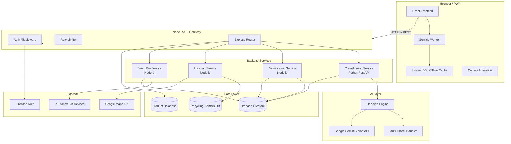
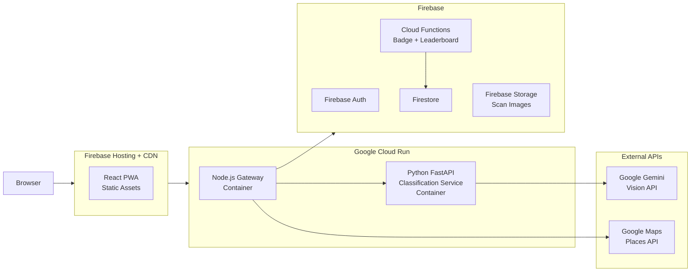

# Design Document: EcoScan AI

## Overview

EcoScan AI is a smart waste segregation web application that uses AI-powered image recognition to classify waste items into Reduce, Reuse, or Recycle categories. It targets individual users (B2C) and waste management organizations (B2B), with a focus on the Indian market aligned with the Swachh Bharat mission.

The system combines a React.js frontend with a Node.js API gateway and a Python FastAPI AI service, backed by Google Gemini Vision API for classification, Firebase Auth + Firestore for persistence, and a gamification engine to drive engagement. An interactive Canvas-based particle animation on the home screen provides a distinctive visual identity.

### Tech Stack Summary

| Layer | Technology |
|---|---|
| Frontend | React.js 18, React Context, Canvas API, Workbox (Service Worker) |
| API Gateway | Node.js 20 + Express.js |
| AI Service | Python 3.11 + FastAPI |
| AI Model | Google Gemini Vision API (gemini-1.5-flash) |
| Auth | Firebase Authentication (email/password + Google OAuth 2.0) |
| Database | Firebase Firestore (NoSQL) |
| Barcode | ZXing-js (client-side), quagga2 |
| Geolocation | Browser Geolocation API + Google Maps Places API |
| Hosting | Firebase Hosting (frontend), Cloud Run (backend services) |
| Offline | Workbox Service Worker + IndexedDB |

---

## Architecture

### System Component Diagram



### Data Flow: Image Classification

```
User captures image
    → Frontend encodes image as base64
    → POST /api/classify { image, userId, location }
    → Auth Middleware validates JWT
    → Classification Service receives request
    → Multi_Object_Handler detects object count
        → If single object: direct Gemini call
        → If multiple: bounding box extraction → parallel Gemini calls
    → Decision_Engine applies Confidence_Score + Region_Rules
    → Returns ClassificationResult[]
    → Gamification Service awards Eco_Points
    → Firestore scan record written
    → Response returned to frontend
    → Result screen rendered
```

---

## Components and Interfaces

### Frontend Components

#### Page / Screen Structure

```
App
├── AuthProvider (React Context)
├── AppRouter
│   ├── /                    → HomeScreen
│   │   ├── ParticleCanvas   (interactive background)
│   │   ├── HeroSection
│   │   ├── StreakBadge       (logged-in users)
│   │   └── CTAButtons
│   ├── /scan                → ScanScreen
│   │   ├── CameraFeed
│   │   ├── BarcodeOverlay
│   │   ├── CaptureButton
│   │   └── UploadButton
│   ├── /result/:scanId      → ResultScreen
│   │   ├── ClassificationCard
│   │   ├── ConfidenceBar
│   │   ├── BinColorIndicator
│   │   ├── ReuseIdeasList
│   │   ├── EcoTipCard
│   │   ├── RecyclingCenterMap
│   │   ├── SmartBinButton
│   │   └── ShareButton
│   ├── /dashboard           → DashboardScreen
│   │   ├── StatsOverview
│   │   ├── WeeklyBarChart
│   │   ├── MaterialPieChart
│   │   ├── BadgeGrid
│   │   ├── LevelProgressBar
│   │   └── CouponList
│   └── /leaderboard         → LeaderboardScreen
│       ├── FilterBar (city / college)
│       ├── LeaderboardTable
│       └── UserRankCard
└── SharedComponents
    ├── Navbar
    ├── OfflineBanner
    ├── ErrorBoundary
    └── LoadingSpinner
```

#### State Management

React Context is used with `useReducer` for predictable state transitions. Three contexts are defined:

- `AuthContext` — current user, JWT token, session state
- `ScanContext` — active scan, classification results, offline queue
- `GamificationContext` — Eco_Points, Eco_Level, badges, streak count

Redux is intentionally avoided to keep the bundle lean for a hackathon-scale app. If the app scales, Zustand is the recommended migration path.

#### Interactive Background Animation (Canvas)

The `ParticleCanvas` component renders on a `<canvas>` element behind the hero content using `requestAnimationFrame`. Particles represent waste icons (recycling symbol, leaf, bottle, can) drawn as emoji or SVG paths.

**Behavior:**
- 40–60 particles float upward with slight horizontal drift
- On `mousemove`, each particle calculates distance to the cursor; particles within 120px radius are repelled with a force inversely proportional to distance
- Particles wrap around screen edges
- Canvas is sized to `window.innerWidth × window.innerHeight` and resized on `resize` event
- Animation is paused via `IntersectionObserver` when the canvas is not visible
- Total animation budget: ≤ 2ms per frame (measured via `performance.now()`)

**Performance constraint (Req 10.7):** The canvas element is loaded lazily after the first paint using dynamic import, ensuring it does not block the critical rendering path. The 500ms load-time budget is enforced by deferring the canvas script.

#### Responsive Breakpoints

| Breakpoint | Width | Layout |
|---|---|---|
| Mobile S | 320px | Single column, stacked cards |
| Mobile L | 425px | Single column, larger tap targets |
| Tablet | 768px | Two-column result layout |
| Desktop | 1024px | Three-column dashboard |
| Wide | 1440px | Max-width container centered |

### Backend Services

#### Node.js API Gateway

Responsibilities: JWT validation, rate limiting, request routing, error normalization.

```
POST   /api/classify              → Classification Service
POST   /api/classify/barcode      → Barcode lookup + Classification Service
GET    /api/recycling-centers     → Location Service
GET    /api/region-rules          → Location Service
GET    /api/dashboard/:userId     → Gamification Service
GET    /api/leaderboard           → Gamification Service
POST   /api/smart-bin/command     → Smart Bin Service
GET    /api/products/:barcodeId   → Product Database
POST   /api/auth/verify           → Firebase Auth verification
PATCH  /api/users/:userId/profile → User profile update
DELETE /api/users/:userId         → Account deletion
```

**Middleware stack (applied in order):**
1. `helmet()` — security headers
2. `cors()` — configured origin whitelist
3. `express-rate-limit` — 60 req/min per IP for public routes, 200 req/min for authenticated
4. `morgan` — request logging
5. `jwtVerify` — custom middleware calling Firebase Admin SDK `verifyIdToken`
6. `errorHandler` — normalizes all errors to `{ error: string, code: string, retryable: boolean }`

#### Python FastAPI Classification Service

```python
POST /classify
    Body: ClassifyRequest { image_b64: str, location: Location, user_id: str }
    Response: ClassifyResponse { results: ClassificationResult[], scan_id: str }

POST /classify/batch
    Body: BatchClassifyRequest { images: list[str], ... }
    Response: BatchClassifyResponse { results: list[ClassificationResult[]] }
```

Internal flow:
1. Decode base64 image
2. Call `MultiObjectHandler.detect(image)` → list of cropped sub-images + bounding boxes
3. For each sub-image, call `GeminiClient.classify(sub_image, region_rules)`
4. Pass each raw result through `DecisionEngine.resolve(raw, confidence, region_rules)`
5. Persist scan record to Firestore via Firebase Admin SDK
6. Return `ClassifyResponse`

#### Gamification Service (Node.js)

```
POST /internal/gamification/award-points
    Body: { userId, scanId, materialType, isCorrectDisposal }
    → Calculates points, updates Firestore user doc, checks badge triggers, checks level-up

GET  /internal/gamification/leaderboard?filter=city|college&value=...
    → Queries Firestore leaderboard collection, returns top 50

POST /internal/gamification/streak/update
    Body: { userId, scanDate }
    → Updates streak, awards bonus points if streak > 3 days
```

#### Location Service (Node.js)

```
GET /internal/location/recycling-centers?lat=&lng=&material=&radius=
    → Queries Firestore recycling_centers collection with geohash range query
    → Returns sorted by distance (Haversine formula)

GET /internal/location/region-rules?lat=&lng=
    → Resolves city/PIN from coordinates, fetches Region_Rules doc
```

#### Smart Bin Service (Node.js)

```
POST /api/smart-bin/command
    Body: SmartBinCommand { binId, materialType, wasteCategory, binColor }
    Response: SmartBinCommandResponse { commandId, status, compartment }
    → Publishes MQTT message to bin device topic
    → Waits up to 5s for acknowledgement
    → Logs event to Firestore smart_bin_events collection
```

---

## Data Models

### Firestore Collections

#### `users/{userId}`

```typescript
interface UserDocument {
  uid: string;
  displayName: string;
  email: string;
  emailVerified: boolean;
  photoURL: string | null;
  city: string;
  college: string | null;
  ecoPoints: number;           // total accumulated
  ecoLevel: 'Beginner' | 'Eco Warrior' | 'Eco Hero';
  badges: BadgeRecord[];
  streakCount: number;
  streakLastDate: string;      // ISO date "YYYY-MM-DD"
  totalScans: number;
  totalCorrectDisposals: number;
  co2SavedKg: number;
  createdAt: Timestamp;
  updatedAt: Timestamp;
  trustedDevices: string[];    // device fingerprints for "Remember Me"
  accountLockedUntil: Timestamp | null;
  failedLoginAttempts: number;
}

interface BadgeRecord {
  badgeId: string;             // e.g. "plastic_saver"
  name: string;
  awardedAt: Timestamp;
}
```

#### `scans/{scanId}`

```typescript
interface ScanDocument {
  scanId: string;
  userId: string;
  timestamp: Timestamp;
  imageUrl: string | null;     // stored in Firebase Storage
  results: ClassificationResult[];
  pointsAwarded: number;
  scanMode: 'camera' | 'upload' | 'barcode';
  location: GeoPoint | null;
  isOffline: boolean;          // true if classified from cache
  syncedAt: Timestamp | null;
}

interface ClassificationResult {
  objectIndex: number;
  boundingBox: BoundingBox | null;
  itemName: string;
  materialType: MaterialType;
  wasteCategory: WasteCategory;
  binColor: BinColor;
  confidenceScore: number;     // 0–100
  isLowConfidence: boolean;    // confidenceScore < 60
  reuseIdeas: string[];
  ecoTips: string[];
  ecoAlternatives: string[];   // for Reduce category
  disposalInstructions: string;
  decisionLog: DecisionLog;
}

interface DecisionLog {
  rawGeminiCategory: string;
  rawConfidence: number;
  regionRuleApplied: boolean;
  regionRuleId: string | null;
  finalOverride: boolean;
}

type MaterialType = 'plastic' | 'metal' | 'paper' | 'glass' | 'organic' | 'e-waste' | 'textile';
type WasteCategory = 'Reduce' | 'Reuse' | 'Recycle';
type BinColor = 'Blue' | 'Green' | 'Red' | 'Yellow' | 'Black';
interface BoundingBox { x: number; y: number; width: number; height: number; }
```

#### `products/{barcodeId}`

```typescript
interface ProductDocument {
  barcodeId: string;           // EAN-13 / UPC-A / QR value
  productName: string;
  brand: string;
  materialComponents: MaterialComponent[];
  primaryWasteCategory: WasteCategory;
  primaryBinColor: BinColor;
  disposalInstructions: string;
  lastUpdated: Timestamp;
  source: 'manufacturer' | 'community' | 'admin';
}

interface MaterialComponent {
  materialType: MaterialType;
  percentage: number;          // 0–100, components sum to 100
}
```

#### `recycling_centers/{centerId}`

```typescript
interface RecyclingCenterDocument {
  centerId: string;
  name: string;
  address: string;
  location: GeoPoint;
  geohash: string;             // for geohash range queries
  acceptedMaterials: MaterialType[];
  operatingHours: string;
  phone: string | null;
  website: string | null;
  city: string;
  pinCode: string;
}
```

#### `leaderboard/{userId}`

```typescript
interface LeaderboardDocument {
  userId: string;
  displayName: string;
  ecoPoints: number;
  ecoLevel: string;
  city: string;
  college: string | null;
  rank: number;                // denormalized, updated by Cloud Function
  weeklyPoints: number;        // reset weekly by Cloud Function
}
```

#### `smart_bin_events/{eventId}`

```typescript
interface SmartBinEventDocument {
  eventId: string;
  binId: string;
  userId: string;
  scanId: string;
  materialType: MaterialType;
  wasteCategory: WasteCategory;
  compartment: string;
  commandStatus: 'sent' | 'acknowledged' | 'timeout' | 'error';
  timestamp: Timestamp;
}
```

#### `region_rules/{ruleId}`

```typescript
interface RegionRulesDocument {
  ruleId: string;
  city: string;
  pinCodes: string[];
  materialOverrides: MaterialOverride[];  // local rules that override defaults
  guidelinesUrl: string;       // Swachh Bharat or local authority link
  lastUpdated: Timestamp;
}

interface MaterialOverride {
  materialType: MaterialType;
  wasteCategory: WasteCategory;
  binColor: BinColor;
  notes: string;
}
```

### Gamification Data Model

#### Points Calculation

```
base_points = 10
bonus_points = materialType === 'e-waste' ? 20
             : materialType === 'hazardous' ? 20
             : materialType === 'glass' ? 5
             : 0
streak_bonus = streakCount > 3 ? 5 * (streakCount - 3) : 0   // capped at 50
total_points = base_points + bonus_points + streak_bonus
```

#### Eco_Level Thresholds

| Level | Points Range |
|---|---|
| Beginner | 0 – 199 |
| Eco Warrior | 200 – 999 |
| Eco Hero | 1000+ |

#### Badge_System Triggers

| Badge | Trigger Condition |
|---|---|
| Plastic Saver | 10 plastic items correctly disposed |
| Recycling Champion | ≥ 90% recycling rate over 30 days |
| Eco Streak | 7-day consecutive usage streak |
| E-Waste Warrior | 5 e-waste items correctly disposed |
| First Scan | Complete first scan |
| Century Scanner | 100 total scans |

Badge evaluation runs as a Firestore Cloud Function triggered on `users/{userId}` document update. It checks all badge conditions against the updated user document and appends newly earned badges.

#### Streak_System Logic

```
On each scan:
  today = current date (YYYY-MM-DD)
  lastDate = user.streakLastDate

  if lastDate == today:
    // already scanned today, no change
  elif lastDate == yesterday:
    streakCount += 1
    streakLastDate = today
    if streakCount > 3:
      award 5 bonus points
  else:
    streakCount = 1   // reset (missed a day)
    streakLastDate = today
```

#### Leaderboard Update Flow

A Firestore Cloud Function triggers on `users/{userId}` writes where `ecoPoints` changes. It writes a denormalized record to `leaderboard/{userId}`. A scheduled Cloud Function runs nightly to recompute global ranks and reset `weeklyPoints`.

---

## Auth System

### JWT Flow

EcoScan AI uses Firebase Authentication as the identity provider. The frontend obtains a Firebase ID token (JWT) after login. This token is sent as `Authorization: Bearer <token>` on every API request. The Node.js gateway calls `firebase-admin.auth().verifyIdToken(token)` to validate it — no custom JWT signing is needed.

```
User → Firebase Auth SDK (login)
     ← Firebase ID Token (JWT, 1hr expiry)
User → API Gateway (Bearer token)
     → firebase-admin.verifyIdToken()
     ← Decoded user claims { uid, email, emailVerified }
     → Request forwarded to service with userId
```

Token refresh is handled automatically by the Firebase SDK on the client. The 7-day session requirement (Req 8.7) is implemented via Firebase's `setPersistence(browserLocalPersistence)` combined with automatic token refresh.

### Google OAuth 2.0 Integration

Firebase Authentication handles the OAuth 2.0 flow via `GoogleAuthProvider`. The frontend calls `signInWithPopup(auth, googleProvider)`. No custom OAuth server is needed.

### Session Management

- **Standard session:** Firebase ID token auto-refreshed, `browserLocalPersistence`
- **Remember Me (30 days):** `browserLocalPersistence` is the default; the device fingerprint is stored in `users/{userId}.trustedDevices`
- **Password change:** Calls `firebase-admin.auth().revokeRefreshTokens(uid)` which invalidates all existing sessions
- **Account lockout:** After 3 failed attempts, `accountLockedUntil` is set to `now + 15 minutes` in Firestore; the gateway checks this field before processing login requests
- **New device login notification:** A Firestore Cloud Function triggers on `users/{userId}` writes to `trustedDevices` and sends an email via Firebase Extensions (Trigger Email)

---

## IoT Smart Bin API

### REST Endpoint

```
POST /api/smart-bin/command
Authorization: Bearer <jwt>
Content-Type: application/json

Request:
{
  "binId": "bin_campus_a_01",
  "materialType": "plastic",
  "wasteCategory": "Recycle",
  "binColor": "Blue",
  "userId": "uid_abc123",
  "scanId": "scan_xyz789"
}

Response 200:
{
  "commandId": "cmd_20240115_001",
  "binId": "bin_campus_a_01",
  "compartment": "Blue",
  "status": "acknowledged",
  "openDurationSeconds": 10,
  "timestamp": "2024-01-15T10:30:00Z"
}

Response 408 (timeout):
{
  "commandId": "cmd_20240115_001",
  "status": "timeout",
  "fallback": {
    "binColor": "Blue",
    "manualInstructions": "Place item in the Blue recycling bin."
  }
}
```

### Command/Response Structure

The Smart Bin Service publishes an MQTT message to topic `ecoscan/bins/{binId}/command` and subscribes to `ecoscan/bins/{binId}/ack`. If no acknowledgement arrives within 5 seconds, the service returns a 408 with fallback instructions. All events are logged to `smart_bin_events` in Firestore.

---

## Offline Mode

### Service Worker Strategy

Implemented with Workbox. Cache strategies by resource type:

| Resource | Strategy | Cache Name | Max Age |
|---|---|---|---|
| App shell (HTML/JS/CSS) | Cache First | `app-shell` | 30 days |
| Static assets (icons, fonts) | Cache First | `static-assets` | 30 days |
| API: region rules | Stale While Revalidate | `region-rules` | 24 hours |
| API: recycling centers | Network First | `recycling-centers` | 1 hour |
| Classification results | Network First + IndexedDB fallback | — | session |

### Offline Cache Structure (IndexedDB)

```typescript
// IndexedDB database: "ecoscan-offline", version 1

// Object store: "cached_results"
interface CachedResult {
  id: string;              // materialType + hash of image features
  materialType: MaterialType;
  result: ClassificationResult;
  cachedAt: number;        // Unix timestamp
}
// Max 50 entries; LRU eviction when limit reached

// Object store: "pending_syncs"
interface PendingSyncRecord {
  scanId: string;
  userId: string;
  scanData: ScanDocument;
  createdAt: number;
}
// Synced and cleared when connectivity restored via Background Sync API
```

When the device is offline:
1. Service Worker intercepts `POST /api/classify`
2. Checks `cached_results` for a matching `materialType`
3. If found: returns cached result with `isOffline: true` flag
4. If not found: returns a structured offline error response
5. Scan record is written to `pending_syncs`
6. On reconnect: Background Sync fires, pending records are POSTed to `/api/classify/sync`


---

## Correctness Properties

*A property is a characteristic or behavior that should hold true across all valid executions of a system — essentially, a formal statement about what the system should do. Properties serve as the bridge between human-readable specifications and machine-verifiable correctness guarantees.*

The following properties were derived from the acceptance criteria prework analysis. After reflection, redundant properties were consolidated: the low-confidence flag (Req 1.6) is subsumed by the Decision_Engine output property (Req 11.1); streak increment and reset (Req 5.10, 5.11) are combined into a single streak-state-machine property; and the Multi_Object_Handler count upper bound (Req 12.2) is combined with the exact-count property (Req 1.7).

---

### Property 1: Decision_Engine always produces exactly one Waste_Category

*For any* combination of raw AI classifier output, confidence score (0–100), and region rules, the Decision_Engine SHALL return a result containing exactly one Waste_Category value drawn from the set {Reduce, Reuse, Recycle}.

**Validates: Requirements 1.4, 11.1**

---

### Property 2: Confidence_Score is always in range [0, 100]

*For any* classification result produced by the AI_Classifier or Decision_Engine, the confidenceScore field SHALL be a number in the closed interval [0, 100]. Additionally, when confidenceScore < 60, the isLowConfidence flag SHALL be true; when confidenceScore ≥ 60, isLowConfidence SHALL be false.

**Validates: Requirements 1.5, 1.6, 11.3**

---

### Property 3: MaterialType is always a valid enum member

*For any* ClassificationResult returned by the system, the materialType field SHALL be exactly one of: plastic, metal, paper, glass, organic, e-waste, textile — and no other value.

**Validates: Requirements 1.3**

---

### Property 4: Points awarded are always non-negative and follow the formula

*For any* materialType and streak state, the total Eco_Points awarded for a correct disposal action SHALL be ≥ 10 (base points), and SHALL equal `base_points + bonus_points + streak_bonus` where bonus_points and streak_bonus are both ≥ 0 as defined by the points formula.

**Validates: Requirements 5.1**

---

### Property 5: Eco_Level assignment is consistent with point thresholds

*For any* ecoPoints value ≥ 0, the assigned Eco_Level SHALL be: "Beginner" if ecoPoints < 200, "Eco Warrior" if 200 ≤ ecoPoints < 1000, "Eco Hero" if ecoPoints ≥ 1000. No ecoPoints value shall produce an undefined or out-of-range level.

**Validates: Requirements 5.2**

---

### Property 6: Streak state machine is correct for all date transitions

*For any* streak state (streakCount, streakLastDate) and a new scan date:
- If scanDate == streakLastDate: streakCount is unchanged
- If scanDate == streakLastDate + 1 day: streakCount increments by exactly 1
- If scanDate > streakLastDate + 1 day: streakCount resets to exactly 1

In all cases, streakLastDate is updated to scanDate and streakCount is never negative.

**Validates: Requirements 5.10, 5.11**

---

### Property 7: Multi_Object_Handler result count is bounded and exact

*For any* image input where N distinct objects are detected (1 ≤ N ≤ 10), the Multi_Object_Handler SHALL return exactly N ClassificationResult entries — never more than the detected count, and never more than 10.

**Validates: Requirements 1.7, 12.2**

---

### Property 8: Product material components sum to 100%

*For any* ProductDocument in the Product_Database, the sum of all materialComponent.percentage values SHALL equal exactly 100. No individual percentage shall be negative or exceed 100.

**Validates: Requirements 13.1, 13.5**

---

### Property 9: Recycling center results are sorted by distance ascending

*For any* list of recycling centers returned by the Location_Service for a given (latitude, longitude, materialType) query, the results SHALL be ordered such that distance[i] ≤ distance[i+1] for all consecutive pairs.

**Validates: Requirements 3.2**

---

### Property 10: Offline cache never exceeds 50 entries

*For any* sequence of cache insertions into the Offline_Cache, the number of entries in the `cached_results` IndexedDB store SHALL never exceed 50. When the 51st entry is inserted, the least-recently-used entry SHALL be evicted, keeping the count at exactly 50.

**Validates: Requirements 7.1**

---

### Property 11: Classification result always contains all required fields

*For any* successful call to the Classification Service, every ClassificationResult in the response SHALL contain non-null values for: itemName, materialType, wasteCategory, binColor, confidenceScore, at least one reuseIdea, and at least one ecoTip.

**Validates: Requirements 1.2, 9.1**

---

## Error Handling

### Error Response Schema

All API errors are normalized by the gateway error handler:

```typescript
interface ErrorResponse {
  error: string;        // human-readable message
  code: string;         // machine-readable code, e.g. "CLASSIFICATION_FAILED"
  retryable: boolean;   // true if client should offer a retry button
  requestId: string;    // for log correlation
}
```

### Error Scenarios and Handling

| Scenario | HTTP Status | Code | retryable | User Message |
|---|---|---|---|---|
| Gemini API timeout | 504 | `AI_TIMEOUT` | true | "Classification is taking longer than expected. Please try again." |
| Gemini API error | 502 | `AI_SERVICE_ERROR` | true | "AI service is temporarily unavailable. Please retry." |
| No waste item detected | 422 | `NO_ITEM_DETECTED` | true | "No waste item found in the image. Please retake with the item clearly visible." |
| Invalid image format | 400 | `INVALID_IMAGE` | false | "Unsupported image format. Please use JPEG or PNG." |
| Barcode not in database | 404 | `BARCODE_NOT_FOUND` | false | "Product not found. Switching to image analysis." |
| Geolocation denied | 403 | `LOCATION_DENIED` | false | "Location access denied. Please enter your PIN code manually." |
| Smart Bin timeout | 408 | `SMART_BIN_TIMEOUT` | false | "Smart bin did not respond. Please use the {binColor} bin manually." |
| Auth token expired | 401 | `TOKEN_EXPIRED` | true | "Session expired. Please log in again." |
| Account locked | 423 | `ACCOUNT_LOCKED` | false | "Account locked for 15 minutes due to multiple failed attempts." |
| Rate limit exceeded | 429 | `RATE_LIMITED` | true | "Too many requests. Please wait a moment and try again." |

### Frontend Error Handling

- All API calls are wrapped in a `useApiCall` hook that catches errors and dispatches to a global `ErrorContext`
- `ErrorBoundary` components wrap each screen to prevent full-app crashes
- Network errors trigger the `OfflineBanner` component and activate offline mode
- Errors are displayed within 1 second of receipt (Req 10.6) via a toast notification system

---

## Testing Strategy

### Overview

EcoScan AI uses a dual testing approach: property-based tests for universal correctness properties and example-based unit/integration tests for specific behaviors.

**Property-Based Testing Library:** [fast-check](https://github.com/dubzzz/fast-check) (TypeScript/JavaScript) for frontend and Node.js services; [Hypothesis](https://hypothesis.readthedocs.io/) (Python) for the FastAPI Classification Service.

Each property test runs a minimum of **100 iterations** with randomized inputs. Tests are tagged with the property they validate.

### Property-Based Tests

Each correctness property from the design maps to exactly one property-based test:

```typescript
// Tag format: Feature: ecoscan-ai, Property N: <property_text>

// Property 1: Decision_Engine always produces exactly one Waste_Category
// Feature: ecoscan-ai, Property 1: Decision_Engine always produces exactly one Waste_Category
fc.assert(fc.property(
  fc.record({
    rawCategory: fc.constantFrom('plastic', 'metal', 'paper', 'glass', 'organic', 'e-waste', 'textile'),
    confidenceScore: fc.float({ min: 0, max: 100 }),
    regionRules: fc.option(arbitraryRegionRules())
  }),
  ({ rawCategory, confidenceScore, regionRules }) => {
    const result = decisionEngine.resolve(rawCategory, confidenceScore, regionRules);
    return ['Reduce', 'Reuse', 'Recycle'].includes(result.wasteCategory);
  }
), { numRuns: 100 });

// Property 2: Confidence_Score is always in range [0, 100]
// Feature: ecoscan-ai, Property 2: Confidence_Score is always in range [0, 100]
fc.assert(fc.property(
  arbitraryClassificationResult(),
  (result) => {
    return result.confidenceScore >= 0
      && result.confidenceScore <= 100
      && (result.confidenceScore < 60) === result.isLowConfidence;
  }
), { numRuns: 100 });

// Property 6: Streak state machine is correct for all date transitions
// Feature: ecoscan-ai, Property 6: Streak state machine is correct for all date transitions
fc.assert(fc.property(
  fc.record({
    streakCount: fc.nat({ max: 365 }),
    streakLastDate: arbitraryISODate(),
    scanDate: arbitraryISODate()
  }),
  ({ streakCount, streakLastDate, scanDate }) => {
    const result = streakSystem.update({ streakCount, streakLastDate }, scanDate);
    const daysDiff = dateDiffDays(streakLastDate, scanDate);
    if (daysDiff === 0) return result.streakCount === streakCount;
    if (daysDiff === 1) return result.streakCount === streakCount + 1;
    return result.streakCount === 1;
  }
), { numRuns: 200 });
```

```python
# Python / Hypothesis — Classification Service
# Feature: ecoscan-ai, Property 3: MaterialType is always a valid enum member
from hypothesis import given, settings
from hypothesis import strategies as st

VALID_MATERIAL_TYPES = {'plastic', 'metal', 'paper', 'glass', 'organic', 'e-waste', 'textile'}

@given(st.binary(min_size=100, max_size=500_000))  # random image bytes
@settings(max_examples=100)
def test_material_type_always_valid(image_bytes):
    result = decision_engine.classify_mock(image_bytes)  # uses mock Gemini
    assert result.material_type in VALID_MATERIAL_TYPES

# Feature: ecoscan-ai, Property 7: Multi_Object_Handler result count is bounded and exact
@given(st.integers(min_value=1, max_value=10))
@settings(max_examples=100)
def test_multi_object_handler_count_bounded(n_objects):
    mock_image = generate_mock_image_with_n_objects(n_objects)
    results = multi_object_handler.detect_and_classify(mock_image)
    assert len(results) == n_objects
    assert len(results) <= 10
```

### Unit Tests

Unit tests cover specific examples, edge cases, and integration points:

- **Decision_Engine:** low-confidence tiebreaker logic, mixed-material handling, region rule override
- **Gamification Service:** level-up boundary conditions (199→200, 999→1000), badge trigger evaluation, streak bonus calculation
- **Location Service:** Haversine distance calculation, geohash range query construction, 10km→25km radius expansion
- **Auth Middleware:** expired token rejection, locked account rejection, rate limit enforcement
- **Barcode fallback:** unknown barcode triggers AI classification path
- **Offline Cache:** LRU eviction at 50-entry boundary, pending sync queue behavior

### Integration Tests

- End-to-end scan flow: image upload → Gemini mock → Decision_Engine → Firestore write → points award
- Barcode lookup: known barcode → Product_Database → result screen
- Smart Bin command: POST → MQTT publish → acknowledgement → Firestore log
- Auth flow: Google OAuth → Firebase token → gateway verification
- Offline sync: scan while offline → IndexedDB write → reconnect → Firestore sync

### Accessibility Tests

- Automated: axe-core integrated into Vitest component tests
- Manual: keyboard navigation through all 5 screens, screen reader testing with NVDA/VoiceOver

### Performance Tests

- Lighthouse CI in GitHub Actions: target LCP < 3s, TBT < 200ms
- Canvas animation frame budget: `performance.now()` assertions in unit tests (≤ 2ms/frame)
- Classification latency: p95 < 5s measured in integration tests with Gemini mock

---

## Deployment Architecture



**Environments:** Development (local Docker Compose), Staging (Cloud Run preview), Production (Cloud Run with min-instances=1).

**CI/CD:** GitHub Actions — lint → test → build → deploy to Firebase Hosting + Cloud Run on merge to `main`.

---

## Security Considerations

- **JWT validation:** All authenticated endpoints verify Firebase ID tokens server-side via `firebase-admin`; tokens are never trusted client-side only
- **Rate limiting:** 60 req/min unauthenticated, 200 req/min authenticated; classification endpoint limited to 20 req/min to prevent Gemini API abuse
- **Image validation:** Images are validated for MIME type and size (max 10MB) before being sent to Gemini; no server-side execution of image content
- **CORS:** Strict origin whitelist; no wildcard origins in production
- **Firestore rules:** Users can only read/write their own `users/{userId}` document; `leaderboard` and `recycling_centers` are read-only for authenticated users; `smart_bin_events` is write-only for the service account
- **Account lockout:** 3 failed login attempts → 15-minute lockout stored in Firestore, checked server-side
- **Data deletion:** Account deletion triggers a Cloud Function that schedules hard deletion of all user data within 30 days (GDPR/DPDP compliance)
- **Secrets management:** Gemini API key, Firebase service account, and Maps API key stored in Google Secret Manager; injected as environment variables into Cloud Run containers
- **HTTPS only:** Firebase Hosting and Cloud Run enforce HTTPS; HSTS header set via `helmet()`
- **Barcode input sanitization:** Barcode strings are validated against expected formats (EAN-13, UPC-A, QR) before database queries to prevent injection
